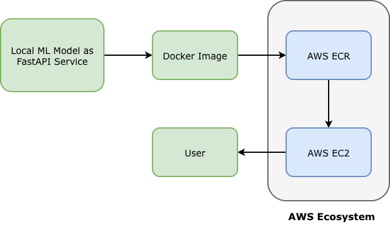

## **Running your first ML model in AWS EC2 with Elastic Container Registry**

### **System Components**



**Pre-requisites**

1. **AWS Account**
2. **Docker**

**To Build an image with Linux Compatibility**
```bash
docker build --platform linux/amd64 -t ml-fastapi-lnx:v1 .
```

### **Install AWS CLI for Mac**
```bash
curl -fsSL https://awscli.amazonaws.com/v2/install.sh | bash
aws --version
```

### **Setup AWS Credentials**

- Create IAM User in AWS Console
- Copy Permissions
- Click Next, and Done
- Click the User created
- Go to Security Credentials
- Create AccessKey
- Add description
- Download the access key and secret access key as .csv file.

```bash
aws configure
• AWS Access Key ID: Enter your access key ID.
• AWS Secret Access Key: Enter your secret access key.
• Default region name: Enter your preferred region (e.g., us-east-1).
• Default output format: Enter json or press Enter to leave it as default
```

### **Creating Public Repository In ECR (Elastic Container Registry)**

- namespace/repo_name

### **Provide access to AWS User to access ECR from Local Machine**

- Go to Users in IAM AWS Console
- Click Users, and then Add Permission.
<!-- - Add Inline Policy
- Select the service to add: "Elastic Container Registry Public"
- select actions: All
- select resources: "all"
- review policy and create. -->

**Add Permission to IAM User**

1. AmazonEC2ContainerRegistryFullAccess
2. AmazonElasticContainerRegistryPublicFullAccess
2. Inline Policy
```json
{
  "Version": "2012-10-17",
  "Statement": [
    {
      "Sid": "AllowPublicECRAuth",
      "Effect": "Allow",
      "Action": [
        "ecr-public:GetAuthorizationToken",
        "sts:GetServiceBearerToken"
      ],
      "Resource": "*"
    }
  ]
}
```

```bash
aws ecr-public get-login-password --region us-east-1 | docker login --username AWS --password-stdin public.ecr.aws
or
aws ecr-public get-login-password --region us-east-1 | docker login --username AWS --password-stdin public.ecr.aws/o4e5e0c8
#login succeeded

docker tag ml-fastapi:v1 public.ecr.aws/o4e5e0c8/ml-images:latest
docker push public.ecr.aws/o4e5e0c8/ml-images:latest
```

**Create EC2 Instance: t3.small, Amazon Linux AMI**

- Create PEM key
- Default security group

chmod 400 ec2-keypair.pem

ssh -i "ec2-keypair.pem" ec2-user@ec2-3-777-98-49.ap-southeast-2.compute.amazonaws.com

**Update security group to allow all traffic**

- Go to default security group
- Edit Inbound rules, add new rule
- Select All traffic as type
- Source Type as Custom
- Source IP: it will be set automatically.
- Add SSH rule in Inbound Rules
- Source: 0.0.0.0/0

**Connect to EC2 Instance**
```bash
ssh -i "ec2-keypair.pem" ec2-user@ec2-3-777-98-49.ap-southeast-2.compute.amazonaws.com
```

**Install Docker**
```bash
sudo yum update -y
sudo yum install -y docker
sudo systemctl start docker
sudo systemctl enable docker
sudo usermod -aG docker ec2-user
sudo chmod 666 /var/run/docker.sock
docker pull public.ecr.aws/o4e5e0c8/ml-images:latest
docker run -d -p 8000:8000 public.ecr.aws/04****/ml-images:latest
```

**Update Security Group to expose port 8000**
Type: Custom TCP, Port: 8000, Source: 0.0.0.0/0

**Access Application from Host**

http://<EC2_PUBLIC_IP>:<Host-Port>
